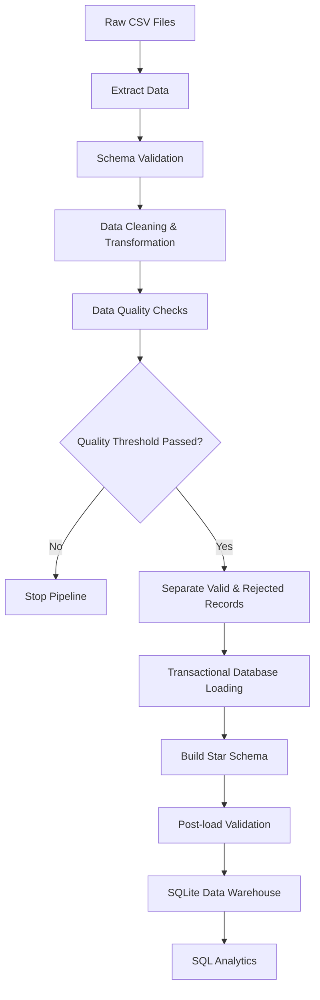

# E-commerce Data Pipeline – Batch ETL & Data Warehouse

## Project Overview

This project implements an end-to-end batch ETL (Extract, Transform, Load) pipeline using Python, Pandas, SQL and SQLite.

The pipeline processes raw e-commerce data from CSV files, performs data cleaning and validation, separates valid and rejected records, and loads the cleaned data into a SQLite data warehouse.

The warehouse uses a **star schema** consisting of customer and product dimension tables and an order fact table. SQL queries are then used to analyse revenue and explore business performance.

The project was developed to gain practical experience with core Data Engineering concepts, including data ingestion, data quality, database transactions, dimensional modelling, SQL analytics and pipeline performance.

## Architecture & Workflow

The pipeline follows a batch ETL architecture with three main stages:

1. **Extract:** Read raw customer, product and order data from CSV files and validate the expected column structure.
2. **Transform:** Clean the data, remove exact duplicates, identify missing required values, validate records and separate valid records from rejected records.
3. **Load:** Load the cleaned and rejected datasets into SQLite using SQLAlchemy transactions. Build the dimensional model and populate the fact table.

### Pipeline Workflow

### Data Warehouse Model

The data warehouse follows a star schema design:

- **dim_customers:** Stores customer information, including customer ID, name, city and email.
- **dim_products:** Stores product information, including product ID, product name and category.
- **fact_orders:** Stores order-level information, including customer and product references, quantity, revenue and payment status.

The fact table connects to both dimension tables through their respective IDs, enabling analytical queries across customers, products and orders.